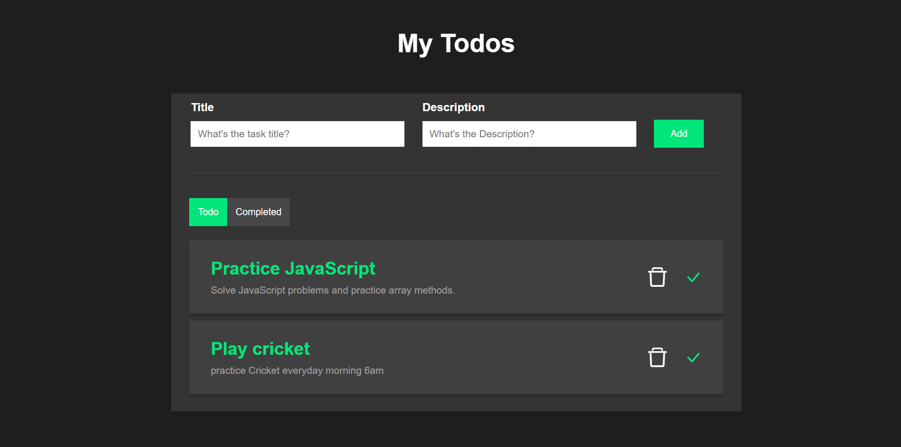
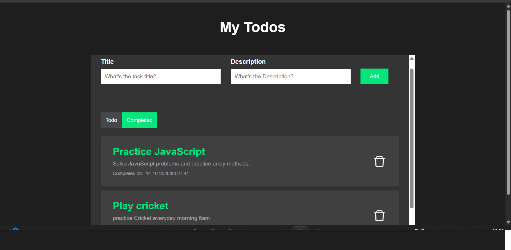

# React Todo List App

A simple, responsive task management application built using React.js. Users can add, complete, and delete tasks while keeping their data saved in the browser using localStorage.

## Features

- **Add Tasks:** Create tasks with a title and description.
- **View Tasks:** See pending and completed tasks in separate sections.
- **Complete Tasks:** Mark tasks as completed with a completion timestamp.
- **Delete Tasks:** Remove pending or completed tasks.
- **Persistent Storage:** Save tasks using browser localStorage, so they remain available after refreshing the page.
- **React State Management:** Update the interface dynamically without refreshing the page.

## Technologies Used

- React.js
- JavaScript (ES6+)
- HTML5
- CSS3
- React Hooks (useState and useEffect)
- React Icons
- Browser localStorage API

## Screenshots

### Todo List


### Completed Tasks

## Getting Started

### Prerequisites

Install Node.js and npm on your computer.

### Installation

1. Clone the repository:

```bash
git clone https://github.com/Narsimhabasa/react-todo-list.git
```

2. Navigate to the project directory:

```bash
cd react-todo-list
```

3. Install dependencies:

```bash
npm install
```

4. Start the development server:

```bash
npm start
```

5. Open http://localhost:3000 in your browser.

## How to Use

1. Enter a task title and description.
2. Click **Add** to create a task.
3. Click the check icon to mark a task as completed.
4. Select **Completed** to view finished tasks and their completion timestamps.
5. Click the delete icon to remove a task.
6. Refresh the browser to confirm that tasks remain saved.

## What I Learned

Through this project, I practiced:

- Creating React functional components
- Managing application state with useState
- Loading saved data with useEffect
- Handling user events
- Rendering dynamic lists using map()
- Working with JavaScript arrays and objects
- Using JSON.stringify() and JSON.parse()
- Saving and retrieving data using localStorage
- Using Git and GitHub for version control

## Future Improvements

- Edit existing tasks
- Task priority levels
- Due dates and reminders
- Search and filtering
- Improved mobile responsiveness

## Author

**Narsimha Basa**

GitHub: [@Narsimhabasa](https://github.com/Narsimhabasa)

## Source Code

[View the project on GitHub](https://github.com/Narsimhabasa/react-todo-list)